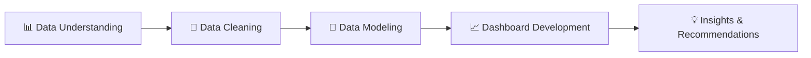

<div align="center">

# 👥 HR Analytics Dashboard

### Transforming raw HR data into actionable workforce insights


</div>

---

## 📑 Table of Contents

- [Project Overview](#-project-overview)
- [Project Workflow](#-project-workflow)
- [Dashboard Pages](#-dashboard-pages)
- [Key Insights](#-key-insights)
- [Recommendations](#-recommendations)
- [Business Value](#-business-value)
- [Tools & Skills](#-tools--skills)
- [Author](#-author)

---

## 📌 Project Overview

The **HR Analytics Dashboard** was developed to analyze workforce data and provide a clear overview of **employee hiring, active employees, resignations, and turnover**.

🎯 **Main objective:** transform raw HR data into meaningful insights that support workforce planning and help management monitor key HR performance indicators.

---

## 🔄 Project Workflow



### 1️⃣ Data Understanding
Reviewed the HR data structure, business context, and relationships between fields, then identified the main HR metrics and dimensions required for the dashboard.

### 2️⃣ Data Cleaning
- ✅ Handling missing values
- ✅ Standardizing data formats
- ✅ Checking inconsistent values
- ✅ Validating fields used in the analysis
- ✅ Preparing the data for modeling and reporting

### 3️⃣ Data Modeling
Created a suitable data model to organize the data and establish the required relationships between tables, providing a reliable structure for the Power BI dashboard.

### 4️⃣ Dashboard Development
Built an interactive Power BI dashboard to analyze HR data from different perspectives.

---

## 📊 Dashboard Pages

| # | Page | Focus |
|:-:|------|-------|
| 1 | 🏠 **Overview** | High-level workforce summary and main HR KPIs |
| 2 | 👨‍💼 **Active Employees** | Current workforce structure and distribution |
| 3 | 🆕 **Hiring Employees** | Hiring patterns during the analyzed period |
| 4 | 🚪 **Resignation Analysis** | Resignation and termination patterns |

> 📸 **Screenshots:** add your dashboard images to an `images/` folder and reference them like this:
>
> ```md
> 
> ```

---

### 🏠 Page 1: Overview

#### 🔑 Key KPIs

| 👥 Active Employees | 🆕 Hiring Employees | 🚪 Resignation Employees | 🔁 Turnover Rate |
|:-------------------:|:-------------------:|:------------------------:|:----------------:|
| **64** | **90** | **26** | **29%** |

#### 📈 Main Visualizations
- Active Employees and Resignations over Time by Year
- Active Employees by Service Length
- Turnover Rate over Time
- Hiring by Gender
- Hiring by Department

---

### 👨‍💼 Page 2: Active Employees Analysis

Focuses on understanding the **current workforce structure** and employee distribution.

| Visualization |
|---------------|
| Active Employees by Manager |
| Active Employees by Education |
| Active Employees by Gender |
| Active Employees by Department |
| Active Employees by Age Group |
| Active Employees by Position |
| Active Employees by Overtime |

---

### 🆕 Page 3: Hiring Employees Analysis

Analyzes employees who were hired during the analyzed period.

| Visualization |
|---------------|
| Hiring Employees by Manager |
| Hiring Employees by Education |
| Hiring Employees by Gender |
| Hiring Employees by Department |
| Hiring Employees by Age Group |
| Hiring Employees by Position |
| Hiring Employees by Overtime |

---

### 🚪 Page 4: Resignation Analysis

Focuses on employee resignations and termination patterns.

| Visualization |
|---------------|
| Resignation Employees by Manager |
| Resignation Employees by Reason |
| Resignation Employees by Gender |
| Resignation Employees by Department |
| Resignation Employees by Age Group |
| Resignation Employees by Position |
| Resignation Employees by Overtime |

---

## 💡 Key Insights

### 🏠 Overview
- 👥 The organization currently has **64 active employees**.
- 🆕 A total of **90 employees** were hired during the analyzed period.
- 🚪 A total of **26 employees** resigned or left the organization.
- 🔁 The overall turnover rate is approximately **29%**.
- 📅 Hiring and resignation activity became more noticeable in the later years of the analyzed period.
- 👨 Male employees represented the larger share of hiring, at **62.22%** of total hires.
- ⏳ Most hires were concentrated within the 0–5 years service categories.

### 🆕 Hiring
- Hiring was distributed across multiple departments and positions.
- The largest hiring groups were the **3–5 years** and **0–2 years** service categories, with **42** and **36** employees respectively.
- A large portion of hiring was concentrated among employees with relatively shorter service periods.

### 🚪 Resignations

| Insight | Value |
|---------|:-----:|
| Total resignation / termination cases | **26** |
| Top reason: Resignation | **11** |
| Second reason: Unfair Dismissal | **10** |
| Top department: Development | **11** |
| Top manager: Leyla | **11** |
| Peak years (2016 and 2019) | **6 each** |

> 📌 The most frequently affected positions were **Administrative Assistant**, **Developer**, and **Programmer Analyst**, with 3 cases each.

---

## ✅ Recommendations

<details>
<summary><b>🔍 1. Investigate High Turnover Periods</b></summary>

Turnover reached relatively high levels in **2017 (56%)** and **2019 (55%)**. HR should investigate workload, compensation, management practices, employee satisfaction, and organizational changes during these periods.
</details>

<details>
<summary><b>🏢 2. Analyze High Resignation Departments</b></summary>

The **Development** department recorded the highest number of cases. A deeper analysis should check whether the pattern relates to workload, management, job characteristics, or career development.
</details>

<details>
<summary><b>👔 3. Review Manager-Level Patterns</b></summary>

Some managers recorded significantly more cases than others. Review these patterns together with tenure, department, position, and overtime data.
</details>

<details>
<summary><b>🤝 4. Strengthen Employee Retention</b></summary>

- Career development opportunities
- Employee engagement programs
- Training and professional development
- Recognition and reward programs
- Regular employee feedback and satisfaction surveys
</details>

<details>
<summary><b>⚖️ 5. Monitor Hiring and Workforce Balance</b></summary>

Since hiring volume is relatively high compared with the current active workforce, HR should continuously monitor the relationship between hiring, resignations, and workforce growth to identify recruitment or retention gaps.
</details>

<details>
<summary><b>📡 6. Build Continuous HR Monitoring</b></summary>

Update the dashboard regularly to monitor:
- Active employees
- New hires
- Resignations
- Turnover rate
- Department-level trends
- Manager-level trends
</details>

---

## 🚀 Business Value

The dashboard provides a centralized view of workforce data and helps HR teams:

- 📌 Monitor key workforce KPIs
- 📈 Understand hiring and resignation trends
- 🔁 Track employee turnover
- 🏢 Analyze workforce distribution across departments and positions
- 🔎 Identify areas that require further investigation
- 🧭 Support workforce planning and HR decision-making
- 🖥️ Monitor HR trends over time through an interactive reporting environment

> The project demonstrates an **end-to-end analytics workflow**: from data understanding and cleaning, to data modeling, and finally an interactive Power BI dashboard with actionable HR insights.

---

## 🛠️ Tools & Skills

| Category | Details |
|----------|---------|
| 📊 Visualization | Power BI |
| 🧹 Data Preparation | Data cleaning, standardization, validation |
| 🧩 Modeling | Relational data modeling |
| 📐 Analysis | KPIs, turnover analysis, trend analysis |

---

## 👤 Author

**Abdulrahman Samhan**
Data Analyst | Student at Assiut University

[](https://github.com/YOUR-USERNAME)
[](https://linkedin.com/in/YOUR-PROFILE)

---

<div align="center">

⭐ If you find this project useful, please give it a star!

</div>

